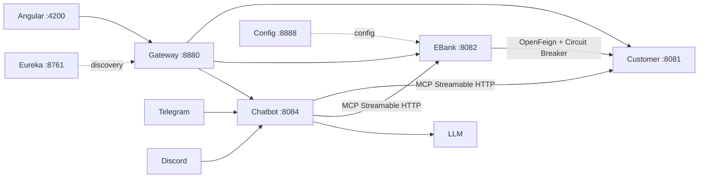

# Projet de synthèse — E-banking et agent Spring AI / MCP

Architecture complète de démonstration locale, avec des clients et comptes **fictifs**.
Java 21 · Spring Boot 3.5.7 · Spring Cloud 2025.0.0 · Spring AI 1.1.0 · Angular 19.
Cette version reste sur Boot 3.5 pour aligner les bibliothèques. Le paramètre `ChatMemory.CONVERSATION_ID` mentionné dans Classroom est utilisé, avec un identifiant distinct par conversation.



## Ollama : exécution locale sans clé OpenAI

Ollama est une option compatible avec l'architecture demandée : Spring AI utilise le modèle local et garde les mêmes outils MCP, la mémoire et les clients Telegram/Discord.
Le fournisseur par défaut est maintenant Ollama avec `llama3.2:3b`, déjà installé sur le poste de développement et doté du support des outils. Un modèle plus grand peut améliorer la fiabilité des appels d'outils si le matériel le permet.

```sh
ollama serve
# Dans un autre terminal, seulement si le modèle est absent :
ollama pull llama3.2:3b
```

Dans `.env` :

```text
AI_PROVIDER=ollama
OLLAMA_BASE_URL=http://localhost:11434
OLLAMA_MODEL=llama3.2:3b
```

Pour utiliser OpenAI à la place, choisir `AI_PROVIDER=openai` et fournir votre propre `OPENAI_API_KEY`. Les deux starters sont présents, mais `spring.ai.model.chat` n'en active qu'un. `python3 smoke.py --chat` effectue un test réel du fournisseur choisi.
Documentation : https://docs.ollama.com/capabilities/tool-calling et https://docs.spring.io/spring-ai/reference/api/chat/ollama-chat.html.

## Démarrer

```sh
./mvnw verify
cd frontend && npm ci && npm run build && cd ..
cp .env.example .env
# Compléter .env dans votre éditeur avec vos propres clés ; ne pas les committer.
python3 dev.py
```

En mode Ollama, aucune clé OpenAI n'est nécessaire : le chatbot démarre après les serveurs MCP. En mode OpenAI, il ne démarre que si votre clé est fournie. Le fichier `.env` est ignoré par Git. Aucune clé publiée dans Classroom n'est incluse dans ce dépôt.
Ouvrir http://localhost:4200 ; Eureka http://localhost:8761 ; Swagger sur 8081, 8082 et 8084.

## Partie 1 — Services métier et résilience

- Customer-Service : CRUD, validation de l'email, JPA/H2, Swagger.
- EBank-Service : création de compte, lecture, filtre par client, crédit/débit, transfert atomique et historique.
- OpenFeign et Eureka relient les deux services.
- Resilience4J protège la consultation d'un client. En cas de panne, `customerStatus.available=false` est explicite ; le solde du compte reste lisible.
- La création de compte vérifie le client et échoue si le service client est indisponible.
- Les transferts utilisent une transaction et des verrous dans un ordre déterministe. Un débit au-delà du solde ou un transfert entre devises est refusé.
- Config Server centralise un fichier de configuration ; la gateway utilise `lb://` et possède aussi un profil `static`.

```sh
curl -s http://localhost:8880/api/customers
curl -s http://localhost:8880/api/accounts
curl -s http://localhost:8888/ebank-service/default
# Remplacer ACCOUNT_ID par une valeur retournée par l'API.
curl -s http://localhost:8880/api/accounts/ACCOUNT_ID
curl -s -X POST http://localhost:8880/api/accounts/ACCOUNT_ID/credit -H 'Content-Type: application/json' -d '{"amount":100}'
curl -s http://localhost:8880/api/accounts/ACCOUNT_ID/operations
```

Pour démontrer le circuit breaker, arrêter Customer-Service et consulter un compte sur **EBank-Service directement** ; constater la disponibilité false. Redémarrer le service, attendre la fenêtre de réouverture puis refaire l'appel.

## Partie 2 — MCP et agent

Customer-Service et EBank-Service publient leurs outils de lecture sur `/mcp` via Streamable HTTP. Les requêtes MCP provenant d'un navigateur ou d'un Host non local sont refusées. Les serveurs sont liés à 127.0.0.1 ; cette démonstration n'est pas un service bancaire à déployer publiquement.

Le chatbot découvre les outils via les deux clients MCP et les expose au modèle avec ToolCallbackProvider. La mémoire est isolée par conversation et limitée aux vingt derniers messages ; elle est volatile.

```sh
curl -s http://localhost:8084/mcp-tools
curl -s http://localhost:8880/api/chat -H 'Content-Type: application/json' -d '{"conversationId":"demo-1","message":"Liste les comptes et leurs soldes"}'
curl -s http://localhost:8880/api/chat -H 'Content-Type: application/json' -d '{"conversationId":"demo-1","message":"Quel client possède le premier compte ?"}'
```

Le chat est volontairement en lecture seule ; les mutations de comptes restent des appels REST explicites pour la démonstration.
`smoke.py` valide la découverte MCP, l'appel réel d'un outil, Feign, gateway, configuration et résilience. Le test de protocole IA emploie un serveur local simulant le fournisseur et le signale explicitement ; il ne prouve pas le fonctionnement d'un compte OpenAI réel.

## Telegram

1. Dans Telegram, créer votre bot via le BotFather officiel et récupérer son token.
2. Définir `TELEGRAM_BOT_TOKEN` et `TELEGRAM_ALLOWED_CHAT_ID` dans `.env`.
3. Redémarrer le projet puis envoyer « Liste les comptes » à votre bot depuis le chat autorisé.
4. Le client utilise getUpdates en long polling et sendMessage ; chaque chat possède sa mémoire.

Le client ne démarre que si token et identifiant autorisé sont présents. Aucun webhook public n'est nécessaire. Le test réel exige votre bot ; aucune capture de conversation n'est fabriquée.

## Discord

1. Créer une application et un bot dans le portail développeur Discord.
2. Activer Message Content Intent, inviter le bot dans votre serveur de test avec lecture/envoi de messages.
3. Définir `DISCORD_BOT_TOKEN` et `DISCORD_ALLOWED_USER_ID` dans `.env`.
4. Redémarrer puis envoyer `!bank Liste les comptes` avec le compte autorisé.

JDA reçoit les messages via la gateway Discord. Les réponses sont divisées selon la limite de taille ; les messages de bots et les utilisateurs non autorisés sont ignorés.

## Tests et limites

Tests métier : transferts atomiques, conservation du total, historique, solde insuffisant, devise incompatible, montant invalide, fallback explicite et création sans faux client. Les tests automatiques ne nécessitent aucune clé externe.
Les données H2 et la mémoire de chat sont réinitialisées au redémarrage. La configuration native est une démonstration de Config Server ; une configuration Git peut remplacer le backend native ultérieurement.

Références : https://www.youtube.com/watch?v=ua5XHtSPI3Y ; https://www.youtube.com/watch?v=cdFz3VemT1Q ; https://www.youtube.com/watch?v=JHvxSZTWSsY ; https://youtu.be/wDheR7_2jkQ ; https://docs.spring.io/spring-ai/reference/1.1/api/mcp/mcp-client-boot-starter-docs.html.
